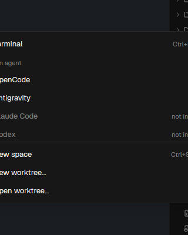

# Orca New Menu

An Orca-style 288px create dropdown for Herdr App. A single click opens a quick popup to launch coding agents (OpenCode, Antigravity, Claude Code, Codex), open new terminal tabs, pick folders, or spin up Git worktrees.

## What you see

Inside a 288px floating popup overlay (`mod.json`: `{ "place": "none", "overlay": { "width": 288 } }`; `tab-bar-surface.tsx:232` `w-72`):

- **Agent Section Header**:
  - `Any agent` label in 11px muted uppercase.
- **Agent Launcher Rows** (`32px` tall, `rounded-md`, `px-2 py-1.5 text-[13px]`):
  - Leading 16px agent icon (`square-terminal.svg` or program icon).
  - Agent name (`OpenCode`, `Antigravity`, `Claude Code`, `Codex`, `Terminal`).
  - Shortcut or badge flush right.
- **Divider** (1px `border`):
  - Subtle divider separating agent launchers from repository operations.
- **Workspace Rows** (`32px` tall):
  - `New space`: folder launcher.
  - `New worktree...`: opens worktree creation prompt.
  - `Open worktree`: directory picker for existing worktrees.

## How it behaves

- **Opening**:
  - Opened as an overlay via `openOverlay({ mod: "new-menu", kind: "popup", width: 288, height: 512 })` or bound key command.
- **Invoking**:
  - Clicking any agent row launches that agent in a new terminal tab and closes the menu.
  - Clicking `New space` invokes the directory picker or opens a new blank space.
  - Clicking `New worktree` triggers the worktree creation dialog.
- **Keyboard Navigation**:
  - Up/Down arrow keys highlight menu rows.
  - Enter or Space executes the highlighted item.
  - Escape closes the overlay (`closeOverlay`).

## Built from

- Mod folder: `mods/new-menu/` (entry `main.js`, schema `mod.json`).
- Assets: `square-terminal.svg`, `folder-open.svg`, `git-branch-plus.svg`, `workflow.svg`.
- Herdr APIs & commands:
  - `tab.new`, `space.new`, `closeOverlay()`, `props()`, `theme()`.
  - `knownAgents()` to enumerate installed agents dynamically.

## Watch out

- Dimensions: Must match Orca's `w-72` (288px) width; an arbitrary width breaks alignment with header triggers.
- Text overflow: Item labels must include `whitespace_nowrap()` and `truncate()` so long agent names do not wrap onto multiple lines.

## Done when

- `herdr-app check mods/new-menu` passes.
- Calling `mod.open {"name": "new-menu"}` renders the 288px dropdown overlay.
- Clicking an agent row creates a new tab and closes the menu.
- Keyboard navigation (arrows + Enter + Esc) works smoothly.
