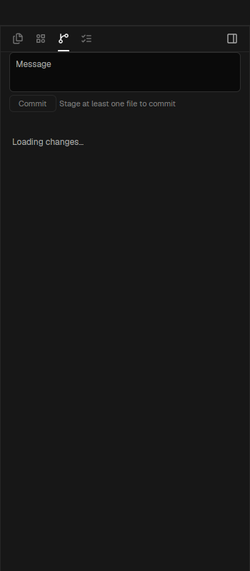

# Orca Changes

An Orca-style Git changes inspector for Herdr App. It splits your modified files into staged and unstaged lists, lets you inspect diffs file by file, stage or discard specific edits, and write commit messages right in the panel with `Ctrl+Enter` to commit.

## What you see

Top to bottom inside the panel:

- **Section Headers** (`32px` tall, padded `px-3`):
  - Collapsible section labels: `Changes` and `Staged Changes` with count pills (`24px` tall, `rounded-full`, `text-xs`).
  - Leading chevron indicator (`chevron-down.svg` or `chevron-right.svg`).
  - Action buttons on hover: Stage All (`plus.svg`) on unstaged section; Unstage All (`minus.svg`) on staged section.
- **Changed File Rows** (`28px` tall, `px-2 py-1`, full-width `rounded-sm`):
  - File status mark: colored letter code (`M` yellow, `A` green, `D` red, `U` blue).
  - Truncated file path in `foreground` (directory prefix in `muted`).
  - Hover action cluster flush right: Stage/Unstage button (`plus.svg` / `minus.svg`), Discard changes button (`trash.svg`).
- **Commit Composer** (bottom block):
  - Multi-line commit message input area with placeholder `Commit message (Ctrl+Enter to commit)`.
  - Primary Commit button: 32px tall, full-width or inline, displaying `Commit to <branch>` with branch icon.
  - Disabled state when no changes are staged.

## How it behaves

- **Staging Controls**:
  - Clicking `+` next to an unstaged file stages it (`git add <file>`).
  - Clicking `-` next to a staged file unstages it (`git restore --staged <file>`).
  - Clicking Discard (`trash.svg`) prompts confirmation and discards working tree changes (`git checkout -- <file>`).
  - Section header `+` stages all files; section header `-` unstages all files.
- **Diff Preview**:
  - Clicking any file row opens or focuses its diff in a terminal or editor pane.
- **Committing**:
  - Entering a message and clicking Commit (or pressing Ctrl+Enter) runs `git commit -m "<message>"`.
  - Staging area clears automatically on successful commit.

## Built from

- Mod folder: `mods/orca-changes/` (entry `main.js`, schema `mod.json`).
- Assets: `changes.svg`, `chevron-down.svg`, `chevron-right.svg`, `plus.svg`, `minus.svg`, `trash.svg`, `undo.svg`, `file.svg`.
- Herdr APIs & commands:
  - `exec` with Git commands (`git diff`, `git add`, `git restore`, `git commit`, `git status`).
  - `watchFolder` for reactive updates on repository edits.
  - All git operations pass `--no-optional-locks -c core.fsmonitor=false`.

## Watch out

- Non-staging commits: Committing must only commit what is staged; never automatically run `git add -A` during commit execution.
- Paint isolation: File status updates must land in the task phase via `cx.timer.after(0)` rather than notifying directly from `render`.
- Non-git spaces: Outside a Git worktree, the mod displays a clean empty state: `Not a git repository`.

## Done when

- `herdr-app check mods/orca-changes` passes.
- Mounting `orca-changes` in a Git repo shows modified files grouped into Changes and Staged Changes.
- Clicking `+` moves an unstaged file to Staged Changes.
- Typing a commit message and clicking Commit executes `git commit` and refreshes the tree.
