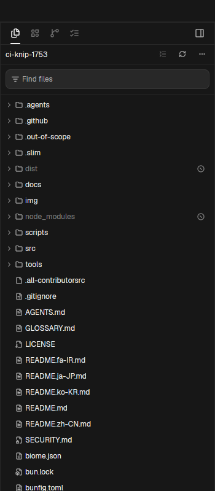

# Orca Files

An Orca-style file explorer panel for Herdr App: a 32px debounced name filter input, full-bleed tree rows indented at 16px per depth, per-extension file type icons covering 30+ language formats, directory-level Git status rollup indicators, and inline file operations.

## What you see

Top to bottom inside the panel block:

- **Filter toolbar band** (32px tall; `FileExplorerNameFilter.tsx:23`):
  - Rounded input container (`h-8 rounded-md border border-border bg-input/50 px-2`).
  - Leading 14px filter icon (`list-filter.svg`) in `muted` color.
  - Transparent text input with placeholder `Find files` (`text-xs`).
  - Trailing clear `×` button when filter text is present.
- **Tree rows container** (scrollable, flexible height):
  - Directory and file rows (`FileExplorerRow.tsx:147-152`): full-width (`w-full`), 28px tall, padded `px-2 py-1`, `rounded-sm text-xs`.
  - Row indent: `depth * 16 + 8` pixels.
  - Chevrons: 14px chevron-right (collapsed) or chevron-down (expanded) for directories.
  - Icons (14px): folder glyph (`folder.svg` or `folder-open.svg`) for directories; extension-matched icons for files (`file-code.svg`, `file-json.svg`, `file-text.svg`, `file-image.svg`, `file-diff.svg`, `file-archive.svg`, etc.).
  - File labels: truncated text in `foreground` (or `muted` for Git-ignored items).
  - Trailing status marks: Git status indicators (`M` modified, `A` added, `D` deleted, `U` untracked) aligned to the right edge.
- **Empty & loading states**:
  - Empty search: `No files matching filter` in `dim` text.
  - Empty folder: `Folder is empty` with a subtle refresh button.
  - Loading: animated turning ring indicator.

## How it behaves

- **Filtering**:
  - Typing into the filter input debounces at 100ms and filters the visible tree.
  - Matching child files causes parent folders to auto-expand to show matching descendants.
  - Escape or clicking the clear button clears the search query.
- **Navigation & Opening**:
  - Clicking a directory toggles its expansion state.
  - Clicking a file opens it or copies its path depending on key modifier (Enter/click opens; Shift+click copies path).
  - Right-clicking any row opens the context menu: Copy Path, Copy Relative Path, Reveal in Terminal, Delete File.
- **Git Rollup**:
  - Modified, added, or untracked statuses inside a collapsed folder bubble up to that folder row's status badge. Deleted files inside a folder do not bubble up (Orca parity).
- **Filesystem Watching**:
  - Automatically re-reads the active folder tree when filesystem changes occur via `watchFolder`.

## Built from

- Mod folder: `mods/orca-files/` (entry `main.js`, schema `mod.json`).
- Helper modules: `clip.js` (clipboard utility).
- Assets: 30+ bundled SVGs for file extensions and UI controls (`list-filter.svg`, `folder.svg`, `folder-open.svg`, `chevron-right.svg`, `chevron-down.svg`, etc.).
- Herdr APIs & commands:
  - `readTextFile`, `watchFolder`, `exec` (`git status --porcelain=v1 --no-optional-locks -c core.fsmonitor=false`).
  - `openOverlay`, `terminal.open`, `props()`, `theme()`.

## Watch out

- Full-bleed rows: Rows must use full-width styling (`w_full()`); otherwise, row hover backgrounds only extend to the text length rather than the panel edge.
- Input transparency: The inner text filter input must be transparent (`bg-transparent`) so it doesn't paint square corners over the rounded container.
- Render notification: Background git and directory refreshes must be deferred using `cx.timer.after(0)` rather than invoking `cx.spawn` synchronously inside `render`, to avoid calling `cx.notify()` during the paint phase.

## Done when

- `herdr-app check mods/orca-files` passes.
- Placing `orca-files` into a panel slot displays the search input and workspace file tree.
- Typing in "Find files" filters matching paths in real time.
- Clicking directory rows expands and collapses child folders with correct indentation.
