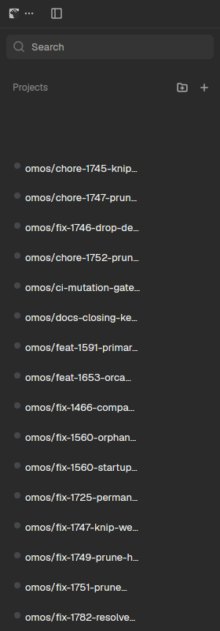

# Orca Spaces

An Orca-style workspace and project group sidebar mod for Herdr App: repositories organized into collapsible project headers, worktrees rendered as cards carrying branch identities, positional `primary` badges on main checkouts, aggregated agent status marks (`working`, `blocked`, `done`, `idle`), and a global collapse-all toggle.

## What you see

Top to bottom in the sidebar:

- **Project Group Headers** (`28px` tall; `worktree-list/rows/SectionHeader.tsx:227-340`):
  - 16px icon slot with folder glyph (`folder.svg`).
  - Project/repo name in `text-[13px] font-semibold leading-4`.
  - Collapse chevron (`20px`, `size-3.5`, `-rotate-90` when collapsed) flush right.
- **Worktree Cards** (`36px` single-line, `py-2`, `rounded-lg`; `worktree-card-surface.tsx:56-70`):
  - Status lane: legacy style (`shrink-0 flex justify-center items-start pt-[2px]`), holding a 12px status mark box around an 8px indicator dot or turning ring.
  - Card Title: 13px line displaying worktree name or branch.
  - Primary Badge (`h-[16px] px-1.5 text-[10px] font-medium rounded`; `worktree-card-header-items.tsx:193`): displayed on the main checkout.
  - Card Meta: 11px line displaying branch, ahead/behind counters, and PR review number mark (`#<number>`).
  - Indentation: nested linked worktrees add 18px indent under their checkout (`indentation.ts`).
  - Agent Rows: child rows under each worktree showing individual running agent turns with status dot and prompt title.

## How it behaves

- **Agent Status Lifecycle**:
  - Rollup follows Herdr's 4 priority states: `blocked` > `working` > `done` > `idle`.
  - `working`: Animated amber turning spinner.
  - `blocked`: Red alert icon for agents waiting for input or permission.
  - `done`: Green checkmark for completed turns.
  - `idle`: Neutral grey dot.
- **Selection & Opening**:
  - Clicking a worktree selects the space (`space.select`).
  - Clicking an unopened worktree opens a new space at that path (`space.new {folder}`).
  - Right-clicking opens the 208px context menu (`Rename`, `Copy Path`, `Open in Terminal`, `New Worktree`, `Close Space`).
- **Folding**:
  - Clicking a project header folds/unfolds that repository's worktrees.
  - Clicking the global Collapse All button toggles fold state across all projects.

## Built from

- Mod folder: `mods/orca-spaces/` (entry `main.js`, schema `mod.json`).
- Helper modules: `indentation.js`, `project.js`, `status.js`, `tip.js`, `focus.js`.
- Assets: `agent-working-spinner.svg`, `circle-check.svg`, `message-circle-question.svg`, `folder.svg`, `git-branch.svg`, `git-pull-request.svg`, `ellipsis.svg`, etc.
- Herdr APIs & commands:
  - `spaces()`, `agents()`, `panes()`, `machines()`.
  - `space.select`, `space.new`, `space.rename`, `space.close`, `terminal.open`, `openOverlay`.
  - `git worktree list --porcelain`, `git status --porcelain=v1` with `--no-optional-locks -c core.fsmonitor=false`.

## Watch out

- Positional primary checkout: `isMainWorktree` is positional (`!linked`, matching the git common dir), never by branch name (`main`/`master`). Exactly one primary badge per repository.
- Key by worktree, not session: Two Herdr spaces open on the same checkout belong to the same card.
- Task-phase ordering: Row ordering must be computed in the task phase (`settleRows`), never dispatching `space.move` during `render`.

## Done when

- `herdr-app check mods/orca-spaces` passes.
- Mounting `orca-spaces` renders project groups with folder icons and worktree cards.
- Main checkouts display the `primary` badge.
- Active agent runs reflect turning spinner or status marks accurately.
