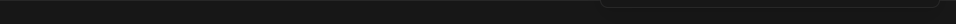

# Orca Status

An Orca-style 24px bottom status bar for Herdr App. It spans the bottom of the window with your active Git branch, dirty file count, ahead/behind sync stats, and real-time agent execution status so you can tell what your tools are doing at a glance.

## What you see

Inside a 24px tall bar spanning the window width (`StatusBarSurface.tsx:121`):

- **Bar Frame**:
  - Height 24px, `px-3 gap-4`, top border 1px `border`, `text-xs`.
- **Git Indicators** (left cluster):
  - Git branch icon (`git-branch.svg`) with branch name.
  - Working tree dirty file count badge.
  - Sync state: commits ahead (`↑`) or behind (`↓`) remote.
- **Agent Status** (center cluster):
  - Live agent status mark: turning amber ring (`working`), green checkmark (`done`), or red alert (`blocked`).
  - Active turn or task summary text.
- **Host & System** (right cluster):
  - Connected host machine indicator.
  - App update availability indicator.

## How it behaves

- **Git Polling**:
  - Runs periodic lock-free git checks (`git status`, `git branch`, `git rev-parse`) to display branch identity and changes without waking file watchers.
- **Agent Rollup**:
  - Reads `agents()` to display aggregate running status across all active terminals.
- **Update Notification**:
  - Highlights when an app update has been downloaded and is ready to apply.

## Built from

- Mod folder: `mods/orca-status/` (entry `main.js`, schema `mod.json`).
- Assets: `alert-circle.svg`, `circle-check.svg`, `refresh-cw.svg`, `server.svg`.
- Herdr APIs & commands:
  - `agents()`, `spaces()`, `machines()`, `exec` (`git`).

## Watch out

- Full-window span: For full-width appearance, the status bar block should sit outside the layout body row directly under the root column.
- Git flags: Always use `--no-optional-locks -c core.fsmonitor=false` when querying git status in background ticks.

## Done when

- `herdr-app check mods/orca-status` passes.
- Mounting `orca-status` renders the 24px bottom bar with branch name and agent status.
- Making git changes updates the dirty indicator.
