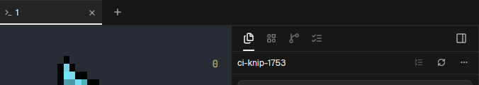

# Orca Tabs

An Orca-style flat tab strip for Herdr App. Tabs sit flat with a full-width 2px bottom underline on the active tab, program icons, close buttons, and tab color dots synced with the menu store. It also includes an integrated sidebar toggle button at the far left so you can show or hide the sidebar anytime.

## What you see

Inside a 36px tall horizontal strip (`main.css:1072-1074` `titlebar`):

- **Sidebar Toggle Button** (`24px`, left edge):
  - 16px `panel-left.svg` icon, padded 4px, `rounded-md`.
  - Toggles the 280px left sidebar on and off without losing tab context.
- **Tabs List** (scrollable horizontal container):
  - Flat tabs (`h-full px-1.5 text-xs`; `SortableTab.tsx:214`).
  - Active tab: background `#171717` (`--card`), text in bright `foreground`.
  - Inactive tab: background 4% foreground over canvas (`drop-indicator.ts:15-22`), text in `muted`.
  - Active indicator: full-width 2px bottom underline bar (`inset-x-0 bottom-0 h-[2px] bg-foreground`).
  - Content: 12px program or terminal icon (`file.svg` / agent icon), tab title text, and hover-revealed 16px close button (`close.svg`).
- **New Tab Button** (`24px`, right edge):
  - Plus icon (`plus.svg`) to open a new terminal tab (`tab.new`).

## How it behaves

- **Tab Selection**:
  - Clicking any tab selects that tab (`tab.select`).
  - Double-clicking a tab enables in-place renaming.
  - Middle-clicking or clicking `×` closes the tab (`tab.close`).
- **Sidebar Control**:
  - Clicking the sidebar toggle button toggles the sidebar's hidden state. Lives in the tab bar so hiding the sidebar never hides the button needed to restore it.
- **Context Menu**:
  - Right-clicking opens the tab context menu: Split Right (`pane.split:right`), Split Down (`pane.split:down`), Copy Tab ID, Close Tab, Close Other Tabs.

## Built from

- Mod folder: `mods/orca-tabs/` (entry `main.js`, schema `mod.json`).
- Assets: `sidebar.svg`, `plus.svg`, `close.svg`, `file.svg`, `git-branch.svg`, `spinner.svg`, `circle-check.svg`, window button icons.
- Herdr APIs & commands:
  - `tab.select`, `tab.new`, `tab.close`, `pane.split`, `layout.hide`, `openOverlay`.
  - `tabs()`, `panes()`, `theme()`.

## Watch out

- Full-width active indicator: Active indicator must be an edge-to-edge 2px bottom underline bar (`inset-x-0 bottom-0 h-[2px]`), not an inset pill.
- Drag regions: Empty space in the tab bar should enable window dragging while tabs and buttons stop click propagation.

## Done when

- `herdr-app check mods/orca-tabs` passes.
- Mounting `orca-tabs` renders flat tabs with the 2px bottom active underline bar.
- Clicking tabs switches active panes smoothly.
- Sidebar toggle button successfully hides and shows the sidebar.
